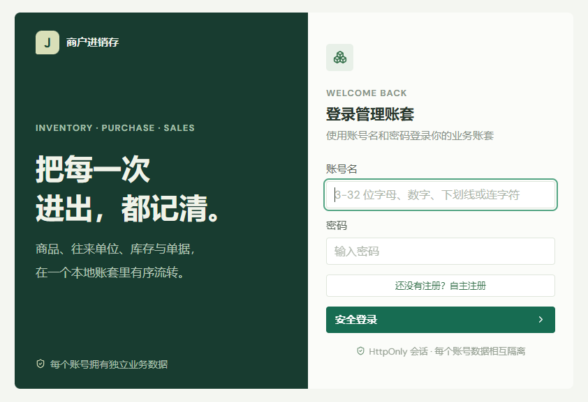
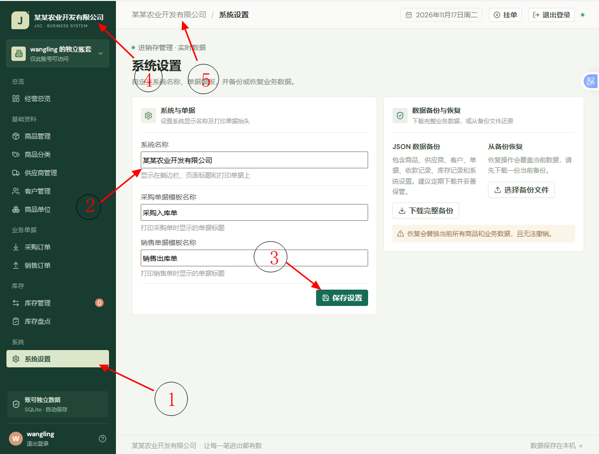
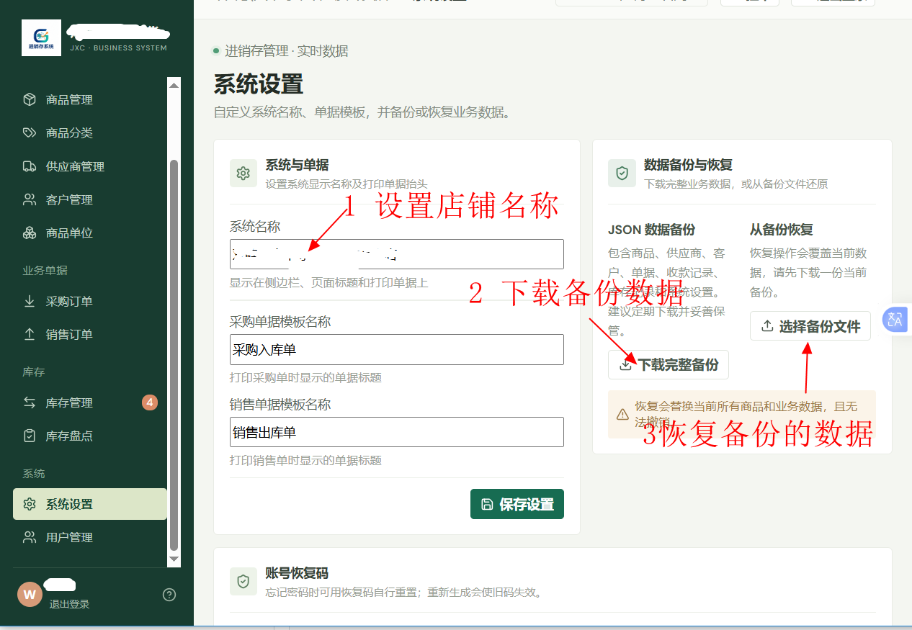
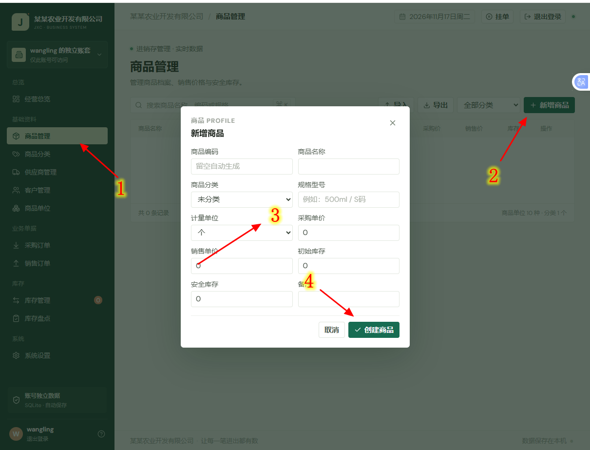
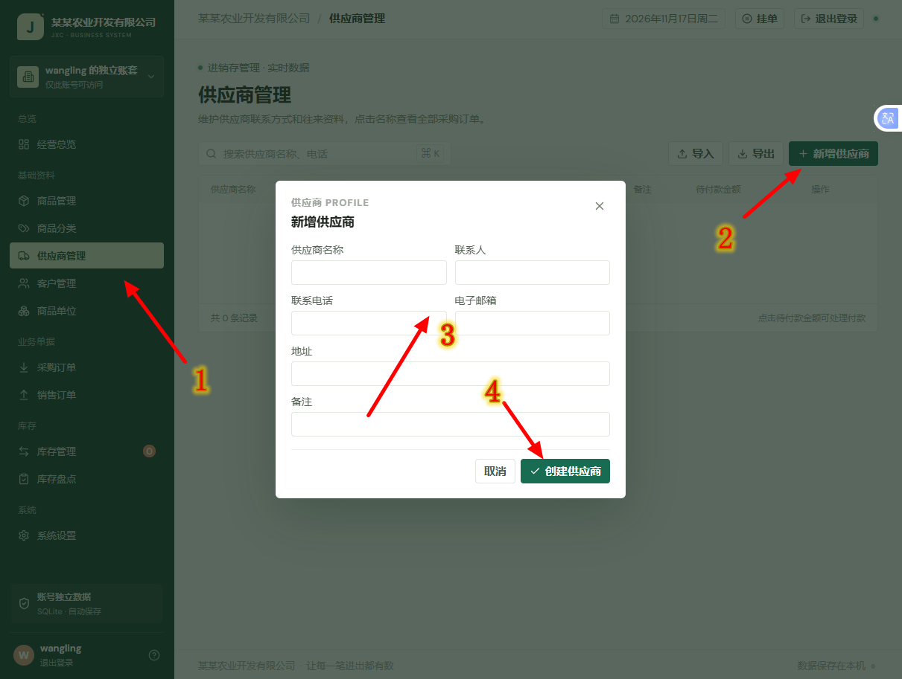
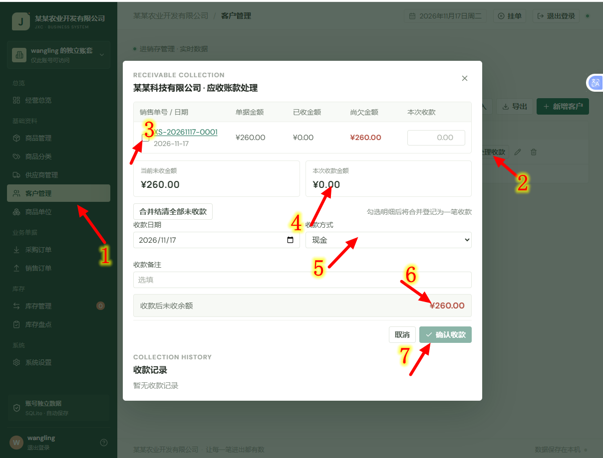
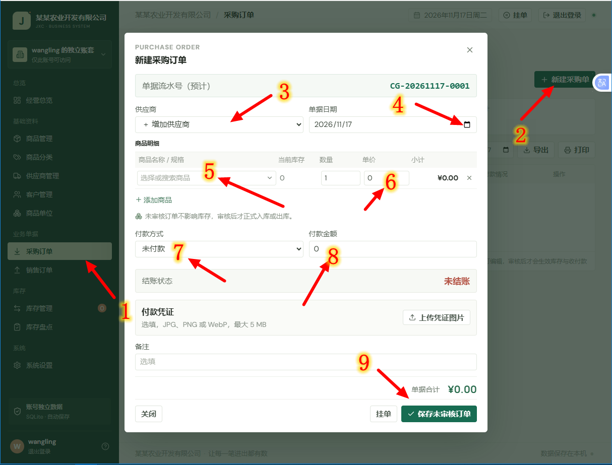
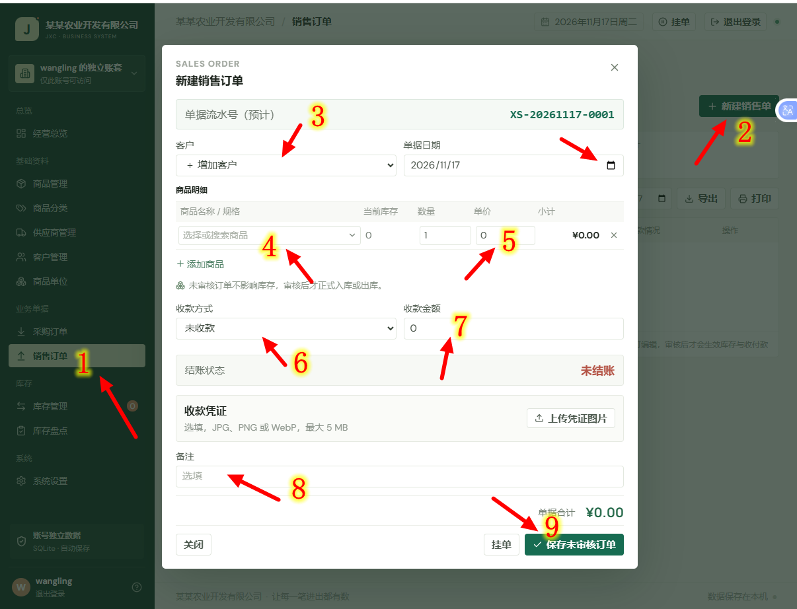

# 这是一个部署在飞牛NAS系统上的DOCKER进销存管理系统

<p align="center">
  
</p>

# 商户进销存系统

面向小型商贸团队的自托管进销存系统。系统使用 React、Express 和 SQLite，支持商品、供应商、客户、采购、销售、库存、应收应付及多账号管理。

## 功能概览

- 商品、商品分类、供应商、客户及计量单位管理
- 商品和往来单位资料的 CSV 导入、导出
- 采购与销售订单管理，支持挂单、审核、反审核、编辑和删除
- 实时库存、库存流水、分类盘点及库存预警
- 采购付款、销售收款及收付款凭证上传
- 应收账款、应付账款及客户/供应商往来明细
- 商户独立账套、账号停用、密码修改和一次性恢复码
- JSON 业务数据备份与恢复
- Docker Compose 部署，数据通过持久卷保存

## 界面预览

### 登录界面

<p align="center"></p>

### 系统设置与备份

<p align="center"></p>

可设置商户名称、下载业务数据备份、恢复历史数据及管理当前账号。

<p align="center"></p>

### 商品管理

<p align="center"></p>

支持新增、编辑、删除商品，维护商品分类、单位、安全库存和库存预警。

### 供应商与客户管理

<p align="center"></p>

<p align="center"></p>

可维护往来单位资料，并查看关联订单、应付账款和应收账款。

### 采购与销售

<p align="center"></p>

<p align="center"></p>

订单支持选择商品、填写数量与价格、登记付款或收款信息，并在审核后更新库存。

## 飞牛 NAS 应用中心

仓库包含可直接交给 `fnpack` 构建的 FPK 应用源码，目录为 [`fnos/jxc`](fnos/jxc)。安装包使用固定版本的 GHCR 多架构镜像，支持飞牛 x86 和 ARM64 设备。

发布新版本时：

1. 同步更新 `package.json`、[`fnos/jxc/manifest`](fnos/jxc/manifest) 和 [`fnos/jxc/app/docker/docker-compose.yaml`](fnos/jxc/app/docker/docker-compose.yaml) 中的版本号。
2. 推送 `v版本号` Git tag，GitHub Actions 会发布 `linux/amd64`、`linux/arm64` 双架构镜像。首次发布前须在 GitHub Packages 中将 `jxc` 镜像设为公开，否则 NAS 无法匿名拉取；若包还不存在，应先通过 Actions 手动运行一次发布工作流，再修改其可见性。发布后不要仅检查工作流状态，还应在未登录 GHCR 的环境确认镜像可匿名拉取。
3. 在 Linux 或飞牛 NAS 上赋予生命周期脚本执行权限并打包：

```sh
chmod +x fnos/jxc/cmd/*
npm run validate:fnos
VERIFY_GHCR=1 npm run validate:fnos
fnpack build --directory fnos/jxc
```

生成的 `.fpk` 可用于应用中心的“本地安装”。提交前应确认 GHCR 镜像已公开且 x86、ARM64 都可拉取，并在测试 NAS 上完成安装、启动、配置端口、升级及两种卸载策略。若安装日志出现 `registry: denied`，说明 FPK 引用的 GHCR 镜像不存在或仍为私有，应修正 Packages 可见性并重新安装，而不是在 NAS 本机配置镜像密码。飞牛官方应用中心公开上架还需要按平台开发者与审核流程提交应用包、隐私与维护信息。

应用安装时仅需选择访问端口，首次打开后注册管理员账号。SQLite 数据库、账号和自动生成的会话签名密钥保存在 fnOS 管理的应用数据目录；卸载时可以选择保留或删除数据。

## NAS Docker 部署

### 1. 准备配置

将项目文件放到 NAS 共享目录，在项目目录复制 `.env.example` 为 `.env`：

```sh
cp .env.example .env
```

`APP_SECRET` 可留空：应用首次启动时会在持久化数据目录生成并复用。需要自行管理该密钥时，也可设置至少 32 位随机值：

```sh
openssl rand -hex 32
```

配置示例：

```env
PORT=3081
APP_PASSWORD=
SUPER_ADMIN=
APP_SECRET=
COOKIE_SECURE=false
```

- `PORT`：NAS 对外访问端口，默认为 `3081`。
- `APP_PASSWORD`：可选；设置后首次启动会创建密码为该值的 `admin` 账号。
- `SUPER_ADMIN`：可选；填写已注册账号，使其获得用户管理权限。
- `APP_SECRET`：可选；留空时自动生成并持久化。自定义值至少 32 位，变更后已有登录会话会失效。
- `COOKIE_SECURE`：仅通过 HTTPS 访问时设为 `true`。

### 2. 启动服务

在项目目录运行：

```sh
docker compose up -d --build
```

也可以在飞牛 NAS Docker 管理界面选择当前目录和 `compose.yaml` 创建项目。

### 3. 访问系统

浏览器打开：

```text
http://NAS地址:3081
```

未配置 `APP_PASSWORD` 时，可在首次访问时注册账号。账号名为 3-32 位字母、数字、下划线或连字符；密码为 8-64 位且同时包含英文字母和数字。

每个账号的商品、库存、订单、设置和备份相互独立。

## 使用说明

### 采购、销售与库存

- 新建采购或销售订单后需要手动审核：采购审核后入库，销售审核后出库。
- 销售审核使用服务器实时库存；多人同时操作时，已过期的挂单修改会被拒绝。
- 只有反审核后的订单可以编辑或删除。
- 反审核会撤销订单对应的库存变动和单内收付款。
- 存在后续已审核订单或独立收付款记录时，系统会阻止反审核。
- 盘点一次处理一个商品分类，不会改变未选择分类的库存。
- 商品被订单或盘点记录引用时不能删除；删除相关订单后，仍会保留历史库存流水中的商品名称和单位。

### 应收与应付

订单可登记已付款、已收款的方式和金额，未结金额会汇总到供应商或客户记录。点击客户或供应商名称可查看关联订单，未结清的款项可继续登记收付款。

非现金收款支持上传 JPG、PNG 或 WebP 凭证，单个文件最大 5 MB。凭证会包含在业务 JSON 备份中。

### 挂单

挂单保存在服务器当前账号的账套中，同一账号可在其他电脑继续处理。打开挂单列表或重新取单时，系统会刷新最新数据和库存。

### CSV 导入导出

商品、供应商和客户页面支持 CSV 导入导出。

- 导出使用当前账套的全部资料，不受搜索或分类筛选影响。
- 建议使用系统导出的 CSV 作为模板，并使用 UTF-8 编码编辑。
- 商品导入会保留库存、安全库存和预警状态，并自动创建不存在的分类与单位。
- 商品编码重复或任一行格式无效时，整批导入会被取消。
- 供应商和客户名称允许重复，重复导入会新增记录。
- CSV 不包含往来余额，完整迁移数据请使用系统备份。

### 备份与恢复

可在“系统设置”下载 JSON 备份。恢复前请先下载当前数据，备份下载后请妥善保存。

业务备份不包含账号、密码或恢复码。迁移整个系统时，还需安全备份 Docker 的 `jxc-data` 持久卷以及 `.env` 配置。

## 用户管理和密码找回

先注册管理员账号，再在 `.env` 中设置：

```env
SUPER_ADMIN=管理员账号
```

然后重新部署。该配置只授予已有账号超级管理员权限，并保留该账号名，防止被新用户抢先注册。

仅超级管理员可以：

- 查看用户注册和启用数量
- 停用或启用用户
- 在核实身份后重置用户密码

超级管理员不能通过页面停用或重置自己的账号。

注册成功后，系统会显示一次性恢复码，请立即复制并安全保存。已有用户可以登录后在“系统设置”生成新恢复码。使用恢复码重置密码后，旧密码、旧恢复码和旧登录会立即失效。

若超级管理员也无法登录，拥有 NAS 服务器操作权限的管理员可在项目目录运行：

```sh
docker compose exec jxc node server.js --reset-super-admin
```

命令只重置 `.env` 中 `SUPER_ADMIN` 指定的账号，并在终端显示一次性临时密码。用户登录后必须立即修改密码，请勿共享终端输出。

## 本地开发

要求 Node.js 22 或兼容版本。

先安装依赖。也可以设置固定的 `APP_SECRET`；留空时开发数据目录会自动生成并保存：

```powershell
npm install
# 可选
$env:APP_SECRET = "请替换为至少32位的随机字符串"
```

启动后端：

```powershell
npm start
```

另开终端启动前端：

```powershell
npm run dev
```

开发页面默认地址为 `http://localhost:5173`，前端会将 `/api` 请求代理到 `http://127.0.0.1:3001`。

生产构建与测试：

```sh
npm run build
node --test tests/*.test.js
```

## 数据与安全

- 数据默认保存在本地 `data/` 目录；Docker 部署使用 `jxc-data` 持久卷，fnOS FPK 使用应用数据目录。
- 未配置 `APP_SECRET` 时，自动生成的 `.app-secret` 会与数据库一起保存在数据目录，请勿单独公开或提交。
- 业务 API 使用 HttpOnly、SameSite Cookie 会话。
- 不要将 `.env`、运行数据或备份文件提交到 Git。
- 未配置 HTTPS 时不要将服务端口直接暴露到公网。
- 通过 HTTPS 反向代理访问时，请设置 `COOKIE_SECURE=true`。
- 建议定期下载各账号的业务备份并在安全位置保存。

## 技术栈

- 前端：React、Vite、Lucide React
- 后端：Node.js、Express
- 数据库：SQLite / better-sqlite3
- 部署：Docker、Docker Compose

如果您觉得这个系统对你有用，记得请我喝咖啡
<p align="left"></p>